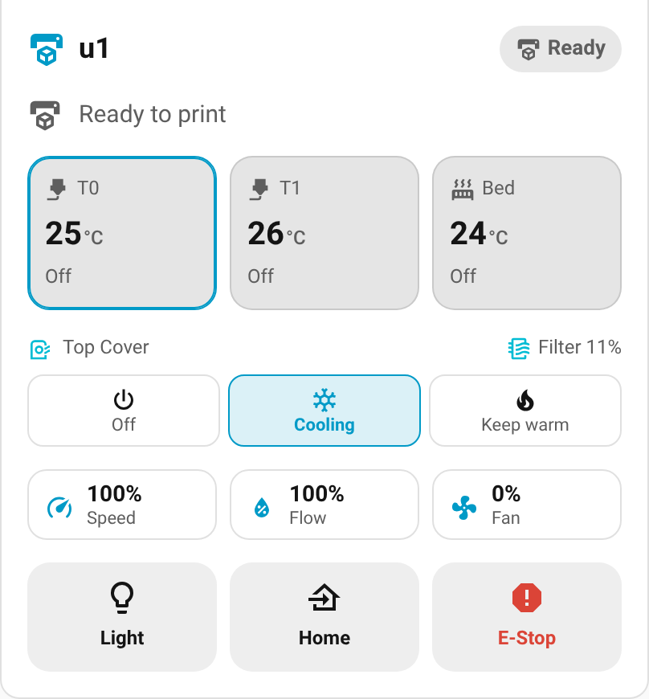
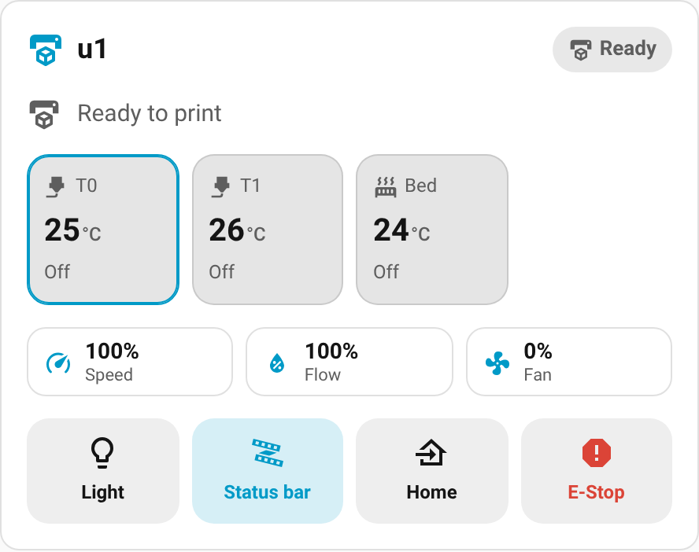
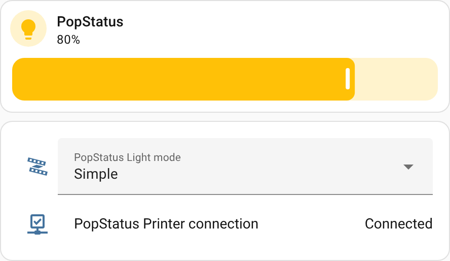
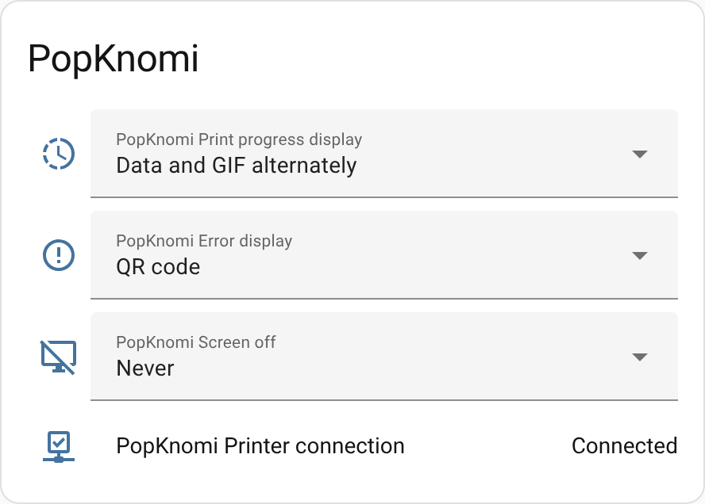

# ha-snapmaker-u1

> A Home Assistant custom integration for the **Snapmaker U1** 3D printer,
> inspired by [ha-bambulab](https://github.com/greghesp/ha-bambulab).
> Live status, temperatures, loaded filament colours, camera, print controls,
> official Top Cover, BIQU Panda Breath, PopStatus and PopKnomi support, and a
> built-in dashboard card. No cloud needed.


<sub>Mockups of the bundled dashboard card rendered with sample data. Your card
shows your printer's real camera and values.</sub>

## Contents

- [How it works](#how-it-works)
- [Features](#features)
- [Dashboard card](#dashboard-card)
- [Filament type and colour](#filament-type-and-colour)
- [Panda Breath / DragonBreath chamber heater](#panda-breath--dragonbreath-chamber-heater)
- [Official Top Cover](#official-top-cover)
- [BIQU PopStatus light bar](#biqu-popstatus-light-bar)
- [BIQU PopKnomi status display](#biqu-popknomi-status-display)
- [Installation](#installation)
- [Configuration](#configuration)
- [Authentication](#authentication)
- [Automations](#automations)
- [Troubleshooting](#troubleshooting)
- [Technical notes](#technical-notes)

---

## How it works

The Snapmaker U1 runs a modified **Klipper** firmware with a modified **Moonraker**
API server. This integration connects directly to that API over your local network
using:

- **WebSocket** (JSON-RPC 2.0) at `ws://<printer-ip>/websocket` for real-time
  push updates (no polling delay).
- **HTTP REST** at `http://<printer-ip>/` as a fallback and for sending commands.

No Snapmaker account or cloud connection is required. The integration does
**not** include its own Moonraker; it talks to the one running on the printer.

---

## Features

### Sensors
| Entity | Description |
|---|---|
| Print State | `standby` / `printing` / `paused` / `complete` / `error` / `cancelled` |
| Print Progress | Percentage complete |
| Current Layer / Total Layers | Layer counter for the current print |
| Print Duration | Active printing time (excludes pauses; updated every 10 s) |
| Total Duration | Time since the print started (includes pauses; updated every 10 s) |
| Time Remaining | Estimated time left (updated every 10 s) |
| Print ETA | Estimated finish time, to the minute (timestamp) |
| Filament Used | Millimetres of filament consumed |
| Filename | Name of the file being printed |
| Bed Temperature / Bed Target | Heated-bed current and target temperature |
| T0–T3 Nozzle Temperature / Target | Per-nozzle current and target temperature (auto-detects up to 4) |
| T0–T3 Filament | Loaded filament, e.g. `PLA Basic`, or `Empty`. Colour, vendor and more as attributes ([details](#filament-type-and-colour)) |
| Chamber / extra temperature sensors | Every Klipper `temperature_sensor` (e.g. chamber, MCU) |
| Panda Breath Temperature | Chamber heater temperature, if present ([details](#panda-breath--dragonbreath-chamber-heater)) |
| Top Cover Filter Used / Filter Life / Circulation Fan RPM | Filter hours used, % life left and fan speed, if the official Top Cover is fitted ([details](#official-top-cover)) |
| Part Cooling Fan | Fan speed in % |
| Print Speed / Flow Rate | Current speed and flow overrides in % |
| Klipper State | `ready` / `startup` / `shutdown` / `error` |
| Toolhead Position | X/Y/Z coordinates (with individual attributes). **Disabled by default**: it changes with every move, so enable it under the entity's settings if you need it (updated every 10 s) |

### Binary sensors
| Entity | Description |
|---|---|
| Printer Ready | On when Klipper reports `ready` |
| Printing | On while a print is running |
| Paused | On while a print is paused |
| Error | On when a Klipper/print error is active (message in attributes) |
| Filament runout | One per filament sensor (the U1's `filament_motion_sensor e0…e3` and any `filament_switch_sensor`); on when filament is **not** detected |
| Printer connection (PopStatus / PopKnomi) | On while a BIQU accessory is connected to the printer ([PopStatus](#biqu-popstatus-light-bar), [PopKnomi](#biqu-popknomi-status-display)) |

### Buttons
| Button | Action |
|---|---|
| Pause Print / Resume Print / Cancel Print | Control the active print |
| Emergency Stop | Immediately halts all motion |
| Home All Axes | `G28` |
| Home X / Y / Z | Home a single axis |
| Restart Klipper | Restarts the Klipper process |
| Reset Top Cover Filter | Resets the filter counter after fitting a new filter (Top Cover only) |

### Controls (numbers, selects, switches, lights)
| Entity | Description |
|---|---|
| Bed Target Temperature | Set the bed temperature (0–120 °C) |
| T0–T3 Target Temperature | Set each nozzle temperature (0–300 °C) |
| Part Cooling Fan Speed | 0–100 % |
| Print Speed Override / Flow Rate Override | `M220` / `M221` |
| Panda Breath Target | Chamber heater target; `0` turns it off, otherwise between its min and max (e.g. 15–70 °C) |
| Print File | Pick a file from the printer and start printing it ([details](#starting-a-print)) |
| Active Tool | Switch between T0–T3 |
| Work Light | The cavity light (reads its real state from the printer) |
| DragonBreath Filter | Chamber filter fan, if present |
| Top Cover Mode / Exhaust Fan / Circulation Fan | Official Top Cover purifier mode and fans, if fitted ([details](#official-top-cover)) |
| PopStatus Light / Light mode | BIQU PopStatus light bar on/off, brightness and Simple/Advanced mode ([details](#biqu-popstatus-light-bar)) |
| PopKnomi Print progress display / Error display / Screen off | BIQU PopKnomi screen settings ([details](#biqu-popknomi-status-display)) |

### Starting a print
The **Print File** select lists the G-code files on the printer, newest
first. New uploads appear automatically. **Choosing a file starts printing
it immediately**, so double-check the file and that the bed is clear.

It's a dropdown, so on a dashboard use the tile card's *Select options*
feature (not *Toggle*), or an entities card:

```yaml
type: tile
entity: select.<printer>_print_file
features:
  - type: select-options
```

While a print is running or paused, choosing a file shows an error instead
of starting a second print. The entity is unavailable while the printer
isn't ready or has no files. You can also start a print from an automation
with `snapmaker_u1.start_print`.

### Camera
- **Webcam**: camera URLs are discovered from Moonraker (`/server/webcams/list`),
  falling back to `/webcam/snapshot.jpg` and `/webcam/stream.mjpg`.
- If the snapshot endpoint fails, a frame is taken from the MJPEG stream
  instead. That also wakes a stock U1 camera that has gone idle.
- The live view proxies the printer's MJPEG stream directly.
- The URLs in use are shown as `snapshot_url` / `stream_url` attributes on
  the camera entity.

> **Note:** The camera is served by the **printer**, not by Home Assistant.
> Test camera URLs against the printer's IP, e.g.
> `http://<printer-ip>/webcam/snapshot.jpg`, not your Home Assistant address.

### Services
| Service | Description |
|---|---|
| `snapmaker_u1.execute_gcode` | Send any G-code command or macro |
| `snapmaker_u1.set_bed_temperature` | Set heated-bed target (°C) |
| `snapmaker_u1.set_nozzle_temperature` | Set a nozzle target (°C) by extruder index |
| `snapmaker_u1.start_print` | Start a file that is already on the printer |

All services take the printer's `config_entry_id`.

### Diagnostics
**Settings → Devices & Services → Snapmaker U1 → ⋮ → Download diagnostics**
gives you the printer state, connection status, camera URLs and Top Cover
state. Your API key is redacted automatically. A PopStatus or PopKnomi entry
has its own diagnostics with its address and last reported settings.

---

## Dashboard card

The integration ships its own dashboard card, styled like the
[Printer Tools](https://github.com/62fixolab/Printer-Tools-App) app. The
integration adds it to your dashboard resources automatically (Settings →
Dashboards → ⋮ → Resources), so there's nothing extra to install. If you manage
dashboards in YAML mode, it's loaded as an extra frontend module instead.

**Edit dashboard → Add card → search "Snapmaker U1"**, or in YAML:

```yaml
type: custom:snapmaker-u1-card
```

| Printing (light) | Printing (dark) |
|---|---|
|  |  |

| Paused (teal accent, camera hidden) | Idle with filament alert (blue accent) |
|---|---|
|  |  |

What it shows:
- 📷 **Live camera** at the top. Tap it to open the full camera view. If live
  video isn't available, it falls back to a snapshot every 5 seconds.
- 🟠 **Status pill**: Printing, Paused, Complete, Ready, Error or Offline.
- ⭕ **Progress ring** with the file name, layer (e.g. 142 / 230), time
  remaining, ETA and elapsed time.
- 🌡️ **Temperature tiles** for each nozzle (T0–T3, with the active tool
  highlighted), the bed, the chamber and the Panda Breath (if present).
  Tap a tile to set its target.
- 🔥 **Chamber heater presets**: one-tap filament buttons (PLA, ABS, PC, …) for a
  Panda Breath / DragonBreath ([details](#filament-presets)).
- 🌬️ **Top Cover**: one-tap Off / Cooling / Keep warm buttons and the filter
  life, if the official Top Cover is fitted ([details](#official-top-cover)).
- 🎨 **Loaded filament** on each nozzle tile: a colour dot and the material
  (e.g. `PLA Basic`). A dashed ring means the nozzle is empty.
- **Speed, flow and fan** at a glance. Tap to adjust.
- ⚠️ **Alerts** for printer errors and filament runout.
- 🎛️ **Controls**: Pause/Resume, Cancel, Light, Filter (Panda Breath), Status
  bar (PopStatus), Home and E-Stop. Cancel and E-Stop need a second tap to confirm.

Options (all optional; all except `chamber_presets` are also in the visual editor):

| Option | Default | Description |
|---|---|---|
| `entry_id` | first printer | Which printer to show, if you have more than one |
| `title` | printer name | Card title |
| `accent_color` | `theme` | `theme`, `orange`, `blue`, `green`, `purple`, `red`, `teal`, `pink`, or any CSS color like `"#ff6600"` |
| `show_camera` | `true` | Show the camera feed |
| `camera_mode` | `live` | `live` video or `snapshot` (refreshed every 5 seconds) |
| `show_controls` | `true` | Show the control buttons |
| `show_chamber_presets` | `true` | Show filament preset buttons for a Panda Breath / DragonBreath |
| `show_top_cover` | `true` | Show the Top Cover mode buttons and filter life |
| `chamber_presets` | see below | Your own preset list (YAML only), e.g. `[{name: ABS, temp: 55}, {name: PLA, temp: 0}]` |

Example:

```yaml
type: custom:snapmaker-u1-card
title: Living Room U1
accent_color: orange
camera_mode: live
```

Light and dark mode follow your Home Assistant theme. Renamed entities keep
working, because the card looks entities up through the integration rather
than by entity ID.

---

## Filament type and colour

The U1 knows what's loaded in each nozzle. With Snapmaker spools it reads
the RFID tag; with other spools it uses what you picked on the touchscreen.
The integration reads this from the printer (Klipper's `print_task_config`
object), so it works on stock firmware with no setup.

Each nozzle gets a **T0–T3 Filament** sensor:

| | Example |
|---|---|
| State | `PLA Basic`, `PETG`, or `Empty` |
| `color` | `#FF6A00` (`null` while unknown) |
| `alpha` | `255` (transparency, 0–255) |
| `material` / `sub_type` | `PLA` / `Basic` |
| `vendor` | `Snapmaker` |
| `loaded` | `true` when filament is in the nozzle |
| `official` | `true` for a Snapmaker RFID spool |

It updates live when you load or change a spool. Example template:

```yaml
{{ state_attr('sensor.<printer>_t0_filament', 'color') }}
```

Notes:
- Third-party spools don't have a Snapmaker RFID tag, so their type and
  colour only appear after you set them on the printer's touchscreen.
- Multi-colour (gradient) spools show their first colour.

---

## Panda Breath / DragonBreath chamber heater

If you run the [U1 Extended Firmware](https://github.com/paxx12-snapmaker-u1/SnapmakerU1-Extended-Firmware)
and have enabled a BIQU **Panda Breath** (or **DragonBreath**) in its Firmware
Config page (`http://<printer-ip>/firmware-config/`), the printer's Klipper
controls the heater. This integration picks it up automatically, with no
extra setup:

| Entity | What it does |
|---|---|
| `sensor.<printer>_panda_breath_temperature` | Chamber heater temperature (attributes: target, power, max_temp) |
| `number.<printer>_panda_breath_target` | Set the chamber target (°C). `0` turns heating off; any other value must be between the heater's Klipper `min_temp` and `max_temp` (e.g. 15–70 °C) |
| `switch.<printer>_dragonbreath_filter` | Filter fan (DragonBreath). The device may refuse to turn it on while heating |

On the dashboard card it appears as a **Panda Breath** temperature tile (tap
to set the target) and a **Filter** button.

Notes:
- After you enable the heater on the printer, the integration picks it up by
  itself once Klipper restarts (it reloads when new Klipper objects appear).
  If it doesn't show up, reload the integration.
- Any Klipper `heater_generic` is treated as a chamber heater, and any
  `output_pin` with "filter" or "breath" in its name as a filter switch.
- With **stock** U1 firmware the Panda Breath isn't visible to the printer.
  In that case, use the Panda Breath's own firmware 1.0.4 MQTT /
  Home Assistant discovery instead.

### Filament presets

The card shows a row of one-tap presets under the temperature tiles. Tap a
filament type and the chamber heater goes to its recommended temperature:

| Preset | Chamber target |
|---|---|
| PLA, TPU | Off (these print best in a cool chamber) |
| PETG | 35 °C (a little warmth helps layer adhesion, far below where PETG softens) |
| ABS, ASA | 50 °C |
| PA (nylon) | 55 °C |
| PC | 60 °C |

- The preset that's currently set is highlighted (Off presets in grey), and a small dot marks
  the filament type that's loaded in a nozzle.
- Targets are kept within the heater's minimum and maximum from the printer's config.
- To use your own values, set `chamber_presets` in the card's YAML (⋮ → *Show code editor*):

```yaml
type: custom:snapmaker-u1-card
chamber_presets:
  - name: PETG
    temp: 40
  - name: ABS
    temp: 55
  - name: PC
    temp: 60
```

---

## Official Top Cover

The Snapmaker U1 **Top Cover** (with its air purifier) works with **stock**
firmware 1.3.0 or later, and with the Extended Firmware. Once the cover is
plugged in, the integration adds:

| Entity | What it does |
|---|---|
| `select.<printer>_top_cover_mode` | **Off**, **Cooling** (exhaust fan; speeds up above 42 °C, for PLA / PETG / TPU), **Keep warm** (filtered circulation with no exhaust, for ABS / ASA / PC) or **Preheat**. Same settings as Snapmaker's slicer |
| `number.<printer>_top_cover_exhaust_fan` | Exhaust fan speed, 0–100 % |
| `number.<printer>_top_cover_circulation_fan` | Circulation (filter) fan speed, 0–100 %. `0` switches it off straight away |
| `sensor.<printer>_top_cover_filter_used` | Hours the filter has been used |
| `sensor.<printer>_top_cover_filter_life` | Filter life left in %, based on Snapmaker's 720-hour recommendation |
| `sensor.<printer>_top_cover_circulation_fan_rpm` | Circulation fan speed (RPM) |
| `button.<printer>_reset_top_cover_filter` | Press after fitting a new filter |



On the dashboard card it appears as a **Top Cover** row with Off / Cooling /
Keep warm buttons and the filter life (red below 10 %). Tap the filter life
for its history.

Notes:
- Plugging the cover in or removing it is detected automatically: the
  integration reloads and adds or removes these entities.
- A print's own start G-code can still change the mode. Snapmaker's slicer sets it
  from the filament type, so the setting in Home Assistant is a manual
  override, not a permanent one.
- The printer turns the purifier off by itself a few minutes after a print ends.

Example automation, a reminder when the filter is nearly used up:

```yaml
automation:
  - alias: "U1 Top Cover filter reminder"
    trigger:
      - platform: numeric_state
        entity_id: sensor.snapmaker_u1_top_cover_filter_life
        below: 10
    action:
      - service: notify.mobile_app_your_phone
        data:
          message: "Time to replace the Snapmaker U1 Top Cover filter."
```

---

## BIQU PopStatus light bar

The [BIQU PopStatus](https://biqu.equipment/products/biqu-popsatus-rhythm-sync-led)
is a separate Wi-Fi light bar that shows the printer's status. To control it
from Home Assistant, add it as its own entry: **Settings → Devices & Services →
Add Integration → Snapmaker U1 → BIQU PopStatus light bar**. Enter its IP
address (or `PopStatus.local`) and pick the printer it belongs to. Home
Assistant checks it can reach the light bar before saving.

It appears as its own **PopStatus** device, linked to the printer:

| Entity | What it does |
|---|---|
| `light.popstatus_light` | Turn the light bar on or off and set its brightness. Brightness applies in **Simple** mode; in Advanced mode, each printer state's effect has its own brightness, set in the PopStatus web UI |
| `select.popstatus_light_mode` | **Simple** (one light style) or **Advanced** (an effect per printer state) |
| `binary_sensor.popstatus_printer_connection` | On while the PopStatus is connected to the printer |

On the dashboard card of the printer you picked, it adds a **Status bar**
button to switch it on and off.

| Status bar button on the card | PopStatus controls in Home Assistant |
|---|---|
|  |  |

Notes:
- The PopStatus still needs to be set up and connected to your printer with
  BIQU's app or its own web page (`http://PopStatus.local`) first. Home Assistant
  only controls the light.
- Effects and colours per printer state are set in the PopStatus web UI.
- It works independently of the printer: its controls load and stay usable
  even when the printer is switched off. They show `unavailable` only when the
  light bar itself can't be reached.
- It's controlled over the same local WebSocket its web page uses (tested
  against its firmware 1.0.0).
- To change its address or printer, use **⋮ → Reconfigure** on its entry. To
  remove it, delete the entry.

---

## BIQU PopKnomi status display

The [BIQU PopKnomi](https://biqu.equipment/products/biqu-popknomi-for-snapmaker-u1)
is a small round Wi-Fi screen that shows the printer's status. Add it like the
PopStatus: **Settings → Devices & Services → Add Integration → Snapmaker U1 →
BIQU PopKnomi status display**, then enter its IP address and pick the printer
it belongs to.

It appears as its own **PopKnomi** device, linked to the printer:

| Entity | What it does |
|---|---|
| `select.popknomi_print_progress_display` | What it shows while printing: **Printing data only**, **GIF only**, **Data and GIF alternately** or **Percentage over GIF** |
| `select.popknomi_error_display` | How errors are shown: **Off**, **QR code** or **GIF** |
| `select.popknomi_screen_off` | When the screen turns off: **Never**, **On standby** or **After 30 minutes idle** |
| `binary_sensor.popknomi_printer_connection` | On while the PopKnomi is connected to the printer |



Notes:
- Set it up and connect it to your printer with BIQU's app or its own web page
  first. GIFs and colours are managed there too.
- Like the PopStatus, it works independently of the printer and uses the same
  local WebSocket as its web page (tested against its firmware 01.00.00.01).
- Example: turn the screen off at night with an automation that selects
  **On standby** at 22:00 and **Never** at 07:00.

---

## Installation

### HACS (recommended)
1. In HACS → **Integrations** → three-dot menu → **Custom repositories**
2. Add this repository URL, category **Integration**
3. Search for "Snapmaker U1" and install
4. Restart Home Assistant

### Manual
1. Copy the `custom_components/snapmaker_u1` folder into your HA
   `config/custom_components/` directory.
2. Restart Home Assistant.

---

## Configuration

1. Go to **Settings → Devices & Services → Add Integration**
2. Search for **Snapmaker U1**
3. Choose what to add:
   - **Snapmaker U1 printer**
   - **BIQU PopStatus light bar** ([details](#biqu-popstatus-light-bar))
   - **BIQU PopKnomi status display** ([details](#biqu-popknomi-status-display))
4. For a printer, enter:
   - **IP Address**: the local IP of your printer (e.g. `192.168.1.42`)
   - **Port**: `80` by default (Moonraker is proxied through nginx)
   - **API Key**: leave blank unless you have configured Moonraker authentication

The integration tests the connection before saving. If it succeeds, all
entities are created immediately. Add the printer first, so a PopStatus or
PopKnomi can be linked to it. Run **Add Integration** again for each extra
printer or accessory.

- **Changed an IP address?** Use **⋮ → Reconfigure** on that printer's (or
  accessory's) entry.
- **Polling interval**: **Configure** on a printer entry sets how often state is
  refreshed while the WebSocket is unavailable.
- **Temperature unit**: **Configure → Temperature unit** picks the unit for
  every printer temperature (sensors, setpoints, the dashboard card and its
  presets). It defaults to **°C**, the usual unit for 3D printing, even if
  Home Assistant itself is set to °F. Choose °F, or *Home Assistant default*
  to follow your system setting.

---

## Authentication

The stock U1 firmware configures Moonraker with trusted LAN clients, so **no
API key is required** if Home Assistant is on the same network as the printer.

If you use the
[Extended Firmware](https://github.com/paxx12-snapmaker-u1/SnapmakerU1-Extended-Firmware)
with forced logins enabled, generate an API key in Moonraker and paste it into
the API Key field.

---

## Automations

Device triggers are available under the printer's device: **Print started**,
**Print complete**, **Print failed**, **Print paused** and **Print cancelled**.
The same moments fire these events:

| Event | When |
|---|---|
| `snapmaker_u1_print_started` | A print starts |
| `snapmaker_u1_print_complete` | A print finishes |
| `snapmaker_u1_print_failed` | A print errors |
| `snapmaker_u1_print_paused` | A print is paused |
| `snapmaker_u1_print_cancelled` | A print is cancelled |

Example: notify when a print is done.

```yaml
automation:
  - alias: "U1 print finished"
    trigger:
      - platform: event
        event_type: snapmaker_u1_print_complete
    action:
      - service: notify.notify
        data:
          message: "Your Snapmaker U1 print is done!"
```

---

## Troubleshooting

| Symptom | Fix |
|---|---|
| "Cannot connect" during setup | Verify the IP, confirm the printer is on and that Fluidd loads in your browser at that address |
| Everything shows `unavailable` | The printer can't be reached (switched off, or off the network). Entities come back by themselves once it answers again; if they don't, check Klipper logs via Fluidd |
| Printer was off when Home Assistant started | Nothing to do: the integration shows *Retrying setup* and connects by itself once the printer is back on. If new heaters or sensors appear after Klipper starts, it reloads itself to add them |
| Camera shows no image / "500: Internal Server Error" snapshot | The integration couldn't get an image from the printer. Open `http://<printer-ip>/webcam/` and `http://<printer-ip>/webcam/snapshot.jpg` in a browser (use the **printer's** IP). If neither shows the camera, the printer isn't exposing its camera over HTTP. The Snapmaker app can reach the camera through its own service, so seeing the feed there doesn't guarantee an HTTP endpoint exists. The [Extended Firmware](https://github.com/paxx12-snapmaker-u1/SnapmakerU1-Extended-Firmware) provides `/webcam/snapshot.jpg` and a live stream. Check the camera entity's `snapshot_url` / `stream_url` attributes and the Home Assistant log (it lists every URL tried) |
| Dashboard card not in the card picker / "Custom element doesn't exist" | Update to 1.10.0 or later, **restart Home Assistant**, then hard-refresh the browser (Ctrl+Shift+R); in the mobile app, use **Reset frontend cache** in the Companion app settings. The integration adds `/snapmaker_u1_static/snapmaker-u1-card.js` to Settings → Dashboards → ⋮ → **Resources** for you (and updates an entry you added by hand). Add the card to a dashboard you created (Settings → Dashboards); newer Home Assistant versions generate the default *Overview* automatically. YAML-mode dashboards: add that URL under `lovelace: resources:` as a `module` |
| Card shows no nozzle tiles | Update to 1.7.2 or later |
| Print File shows "Unavailable" | Update to 1.7.1 or later (older versions misread the printer's file list). It's also unavailable while the printer isn't ready or has no files in its storage |
| PopStatus / PopKnomi entities `unavailable` | Check the device is powered and its address is still right: open `http://<address>` in a browser, and fix it with ⋮ → Reconfigure on its entry if needed. Give it a fixed IP in your router so it doesn't change |
| Top Cover entities missing | Plug the cover in and update the printer to firmware 1.3.0 or later. The entities appear by themselves once the printer detects the cover |
| Panda Breath entities missing | Enable it in the printer's Firmware Config page first (Extended Firmware only), then reload the integration |
| PopStatus / PopKnomi not in the Add Integration menu | Update to 1.12.0 (PopStatus) or 1.13.0 (PopKnomi) or later and restart Home Assistant |
| Sensors fill up the recorder / database | Update to 1.13.1 or later: time sensors update at most every 10 s, the ETA once a minute, and Toolhead Position is off by default. To keep a sensor out of history entirely, exclude it in the [`recorder`](https://www.home-assistant.io/integrations/recorder/) settings |
| Temperatures show 0 after startup | Klipper may still be initialising; values update within seconds once it's ready |

---

## Technical notes

- **Protocol**: Moonraker WebSocket (JSON-RPC 2.0) + HTTP REST
- **IoT class**: `local_push` (push updates via WebSocket, no cloud dependency)
- **Reconnection**: Exponential back-off from 5 s to 60 s, always waiting between attempts (even when the printer closes the socket itself)
- **Availability**: When the connection drops, the integration polls straight away; if the printer doesn't answer, every entity (camera included) shows `unavailable` instead of its last value
- **Recorder load**: values that change with every update while printing
  (print duration, total duration, time remaining, toolhead position) are
  written at most every 10 seconds, and the ETA only when it moves by a minute
- **Extruders**: Up to 4 nozzles auto-detected (T0–T3)
- **Dashboard card**: served by the integration from `/snapmaker_u1_static/`
  and registered as a dashboard resource (an extra frontend module in YAML
  mode); it reads entities through the `snapmaker_u1/entities` websocket command
- **File list**: kept up to date from Moonraker's `notify_filelist_changed`
  details (files and folders); a full re-fetch only happens for a
  `root_update`, at most once a minute
- **Startup**: if the printer is unreachable, setup is retried automatically
- **BIQU accessories**: the PopStatus and PopKnomi are separate config entries
  (linked to a printer) that talk to each device's own local WebSocket
  (`ws://<device>/ws`), the same one its web page uses; they work whether or
  not the printer is on
- **Top Cover**: read from the stock firmware's Klipper `purifier` object;
  controlled with `SET_PURIFIER_MODE` / `SET_PURIFIER`
- **HA version**: Home Assistant 2024.1+
- **Icon**: shipped in `custom_components/snapmaker_u1/brand/` (light and dark,
  256 px and 512 px), which Home Assistant 2026.3+ uses automatically. Older
  versions show a generic icon. Source: `docs/images/icon.svg`

---

## Credits

Architecture inspired by [ha-bambulab](https://github.com/greghesp/ha-bambulab)
by Greg Hesp and Adrian Garside. Dashboard card styled after
[Printer Tools](https://github.com/62fixolab/Printer-Tools-App) by FixoLab.
Panda Breath support builds on the
[U1 Extended Firmware](https://github.com/paxx12-snapmaker-u1/SnapmakerU1-Extended-Firmware)
by paxx12. Top Cover support follows Snapmaker's
[u1-klipper](https://github.com/Snapmaker/u1-klipper) purifier module, and the
PopStatus and PopKnomi protocols come from the web UIs in BIQU's published
firmware ([PopStatus](https://github.com/bigtreetech/PopStatus),
[PopKnomi](https://github.com/bigtreetech/PopKnomi)).

Moonraker API documentation: https://moonraker.readthedocs.io
